# TokTickIT — Lab 4 Submission Report
## Actions Taken, Role-Based Dashboards, Concurrency & Final Regression
**Course:** CPE 334 Introduction to Software Engineering in the Age of AI Agents — KMUTT  
**Semester:** 1/2026  
**Total Score Rubric:** 60 Points (Answer Part 1 to Part 9)

| Item | Student & Project Submission Information |
|:---|:---|
| **Author Name** | Nara Kosiyaporn |
| **Student ID** | 67070505218 |
| **GitHub Username** | [@narakosi-dev](https://github.com/narakosi-dev) |
| **Repository URL** | [https://github.com/narakosi-dev/toktickit](https://github.com/narakosi-dev/toktickit) |
| **Integration Branch** | `lab4-staging` (released into `main` via PR #77) |
| **Peer Reviewers** | Sarin ([@Sxr1n](https://github.com/Sxr1n)), Tantiyawat Chansiri ([@Leviathan-c137](https://github.com/Leviathan-c137)), Natdanai ([@Beethoven190](https://github.com/Beethoven190)) |
| **Test Accounts** | Requester (`nara.kosi@kmutt.ac.th`), IT Staff (`bob.smith@example.com`), Admin (`admin@toktick.local`) |

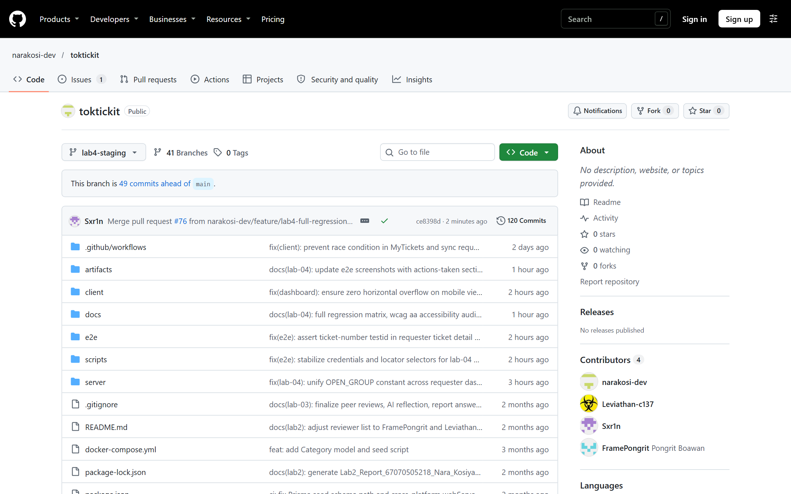
*Figure 0.1: TokTickIT GitHub Repository on `lab4-staging` branch showing clean file hierarchy and structure.*

---

## Answer Part 1: Git Use with Engineering Workflow (10 pts)

### 1.1 Commit History & Linear Staged Integration Flow
The TokTickIT project strictly adheres to professional staged integration and GitHub Flow. All functional increments were developed on dedicated feature branches branched off `lab4-staging`. Each feature branch was merged into `lab4-staging` exclusively via peer-reviewed Pull Requests. Crucially, **no Pull Request was self-merged**; every PR waited for automated GitHub Actions CI verification (100% green across client, server, and E2E suites) followed by formal human peer review and approval from `@Sxr1n` before merging.

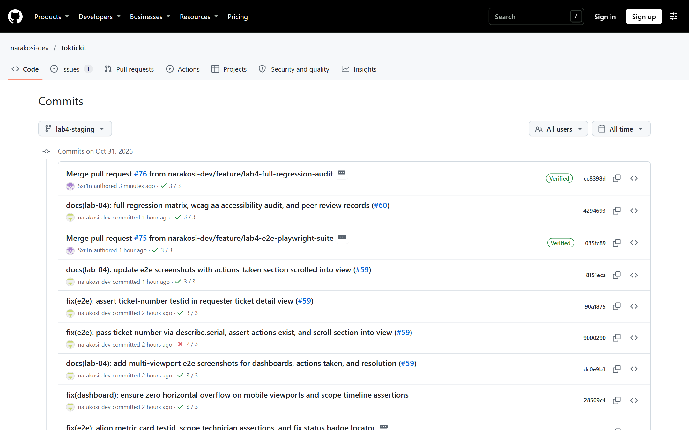
*Figure 1.1: GitHub Commit History on `lab4-staging` showing linear feature merges and review revisions.*

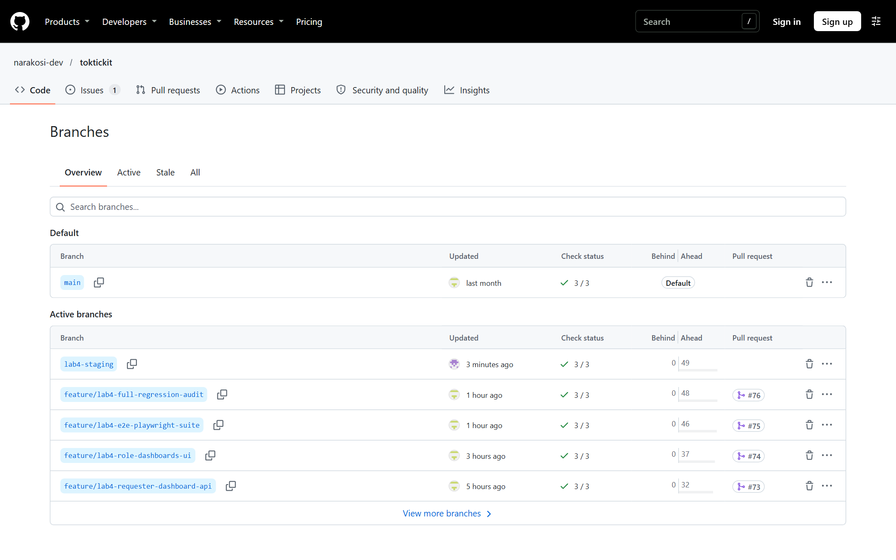
*Figure 1.2: GitHub Branches showing feature branches, `lab4-staging`, and `main`.*

```text
*   ce8398d Merge pull request #76 from narakosi-dev/feature/lab4-full-regression-audit
|\  
| * 4294693 docs(lab-04): full regression matrix, wcag aa accessibility audit, and peer review records (#60)
|/  
*   085fc89 Merge pull request #75 from narakosi-dev/feature/lab4-e2e-playwright-suite
|\  
| * 8151eca docs(lab-04): update e2e screenshots with actions-taken section scrolled into view (#59)
| * 90a1875 fix(e2e): assert ticket-number testid in requester ticket detail view (#59)
| * 9000290 fix(e2e): pass ticket number via describe.serial, assert actions exist, and scroll section into view (#59)
| * dc0e9b3 docs(lab-04): add multi-viewport e2e screenshots for dashboards, actions taken, and resolution (#59)
| * 28509c4 fix(dashboard): ensure zero horizontal overflow on mobile viewports and scope timeline assertions (#59)
| * 641168f test(e2e): playwright end-to-end multi-viewport test suite and responsive captures (#59)
|/  
*   4225d00 Merge pull request #74 from narakosi-dev/feature/lab4-role-dashboards-ui
|\  
| * 04afaf6 fix(lab-04): unify OPEN_GROUP constant across requester dashboard links and quick actions (#58)
| * 832242d fix(lab-04): prevent status filter collision by using OPEN_GROUP and verify status=Open isolation (#58)
| * 1db439c fix(lab-04): connect dashboard drill-downs with accurate query filters and add AppShell integration test (#58)
| * 8dc495f feat(lab-04): frontend role-based dashboards for staff and requester (#58)
|/  
*   b9c3262 Merge pull request #73 from narakosi-dev/feature/lab4-requester-dashboard-api
|\  
| * d73de9b feat(lab-04): backend requester dashboard API and ownership isolation (#57)
|/  
*   0e0ef7c Merge pull request #72 from narakosi-dev/feature/lab4-staff-dashboard-api
|\  
| * 5e659f8 refactor(lab-04): optimize staff dashboard with database-level aggregations and align contracts (#56)
| * a27fdc7 feat(lab-04): implement backend IT staff and admin dashboard APIs (#56)
|/  
*   4ae54fb Merge pull request #71 from narakosi-dev/feature/lab4-ticket-workflow-ui
|\  
| * a579c37 feat(lab-04): frontend ticket status workflow transitions and requester resolution (#55)
|/  
*   c64e526 Merge pull request #70 from narakosi-dev/feature/lab4-actions-taken-ui
|\  
| * dbef573 feat(lab-04): frontend actions taken timeline and responsive modal (#54)
|/  
*   e77caae Merge pull request #69 from narakosi-dev/feature/lab4-ticket-workflow-api
|\  
| * 179bb48 fix(lab-04): dynamically skip db test when postgres is unavailable and document limitation in specs
| * cce2517 test(lab-04): fix mock call args in unit test to match transaction updateMany call
| * 77ca896 feat(lab-04): table-driven tests for BR-06, live db concurrency test, and route delegation
| * daf0612 feat(lab-04): atomic OCC updateMany in transaction, mandatory version, and route unification (#53)
| * db64c48 feat(lab-04): ticket status workflow transition handler and optimistic concurrency control (#53)
|/  
*   a1459a9 Merge pull request #68 from narakosi-dev/feature/lab4-actions-taken-api
|\  
| * f21a37c feat(lab-04): backend actions taken REST APIs and RBAC isolation (#52)
|/  
*   59cffbf Merge pull request #66 from narakosi-dev/feature/lab4-db-seeding
|\  
| * a953cf9 feat(lab-04): canonical database seeding for 8 workflow statuses (#51)
|/  
*   00ddaa1 Merge pull request #65 from narakosi-dev/feature/lab4-db-schema-migrations
|\  
| * 4390be0 feat(lab-04): database schema migration for ActionTaken model and ticket versioning (#50)
|/  
*   e6d97c3 Merge pull request #62 from narakosi-dev/feature/lab4-specs
|\  
| * 42da709 docs(lab-04): sprint 4 engineering specification, architecture, and traceability matrix (#49)
|/  
*   51edd87 (tag: v3.0.0, origin/main) Release Lab 3
```

### 1.2 Kanban Board & Project Management
The team decomposed Sprint 4 into 13 formal GitHub Issues (Issues #49 through #61) tracked across the Kanban lifecycle (`Backlog` $\rightarrow$ `Ready` $\rightarrow$ `In Progress` $\rightarrow$ `In Review` $\rightarrow$ `Done`).

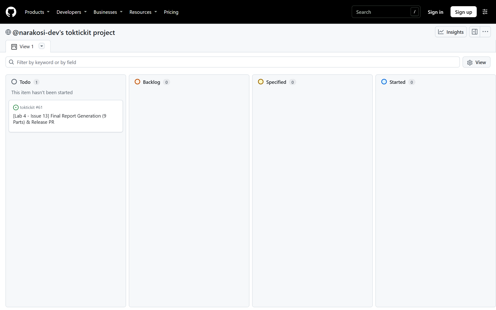
*Figure 1.3: GitHub Projects board showing Lab 4 issues tracked through to completion.*

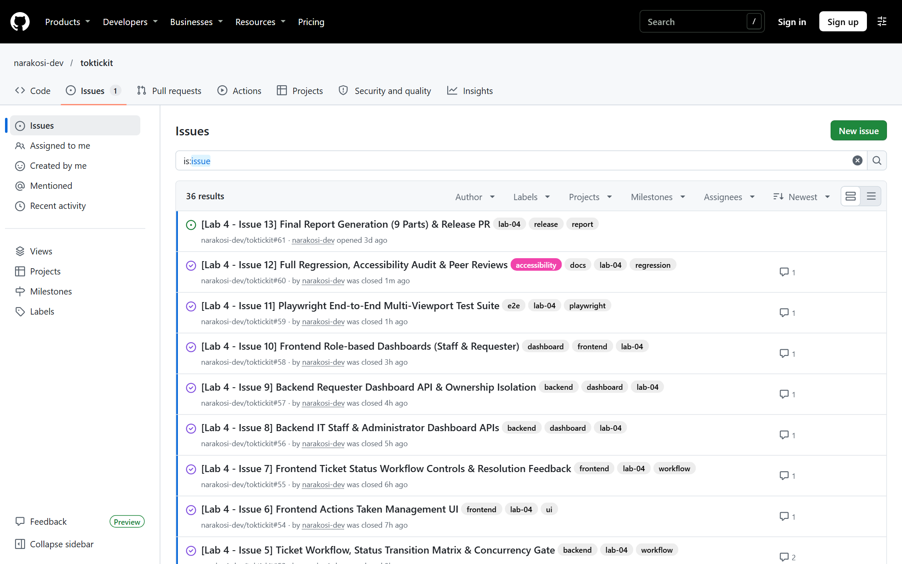
*Figure 1.4: GitHub Issues list showing all 13 sprint task issues in closed/completed state.*

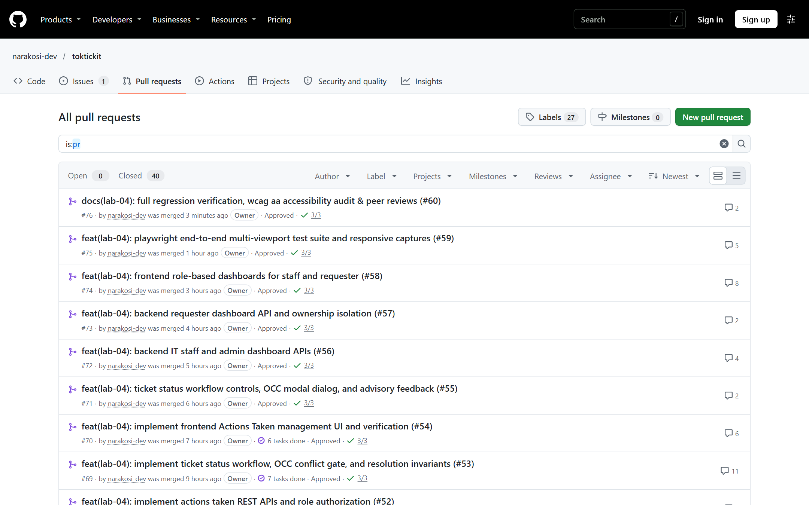
*Figure 1.5: GitHub Pull Requests list showing merged feature PRs targeting `lab4-staging`.*

### 1.3 Rendered Peer Review Record
All 11 feature PRs (#62 through #76) were reviewed and approved by peer `@Sxr1n` prior to integration:

| PR # | Feature Branch | Scope & Deliverables | Reviewer | Status | Merged Commit |
|:---:|:---|:---|:---:|:---:|:---:|
| **#62** | `feature/lab4-specs` | Issue #49: Specification, FSM, and Test Plan | `@Sxr1n` | **Approved** | `e6d97c3` |
| **#65** | `feature/lab4-db-schema-migrations` | Issue #50: ActionTaken Model & Ticket.version | `@Sxr1n` | **Approved** | `00ddaa1` |
| **#66** | `feature/lab4-db-seeding` | Issue #51: Canonical Database Seeding (8 Statuses) | `@Sxr1n` | **Approved** | `59cffbf` |
| **#68** | `feature/lab4-actions-taken-api` | Issue #52: Actions Taken REST APIs & RBAC | `@Sxr1n` | **Approved** | `a1459a9` |
| **#69** | `feature/lab4-ticket-workflow-api` | Issue #53: State Machine, Resolution Gate & Atomic OCC | `@Sxr1n` | **Approved** (4 rounds) | `e77caae` |
| **#70** | `feature/lab4-actions-taken-ui` | Issue #54: Actions Taken Timeline & Modal Form | `@Sxr1n` | **Approved** | `c64e526` |
| **#71** | `feature/lab4-ticket-workflow-ui` | Issue #55: Status Transitions & Requester Indication | `@Sxr1n` | **Approved** | `4ae54fb` |
| **#72** | `feature/lab4-staff-dashboard-api` | Issue #56: Staff & Admin Dashboard Metrics API | `@Sxr1n` | **Approved** | `0e0ef7c` |
| **#73** | `feature/lab4-requester-dashboard-api` | Issue #57: Requester Dashboard API & Isolation | `@Sxr1n` | **Approved** | `b9c3262` |
| **#74** | `feature/lab4-role-dashboards-ui` | Issue #58: Dashboards & Drill-down Navigation | `@Sxr1n` | **Approved** (3 rounds) | `4225d00` |
| **#75** | `feature/lab4-e2e-playwright-suite` | Issue #59: Multi-Viewport Playwright E2E Suite | `@Sxr1n` | **Approved** (2 rounds) | `085fc89` |
| **#76** | `feature/lab4-full-regression-audit` | Issue #60: Full Regression & Accessibility Audit | `@Sxr1n` | **Approved** | `ce8398d` |

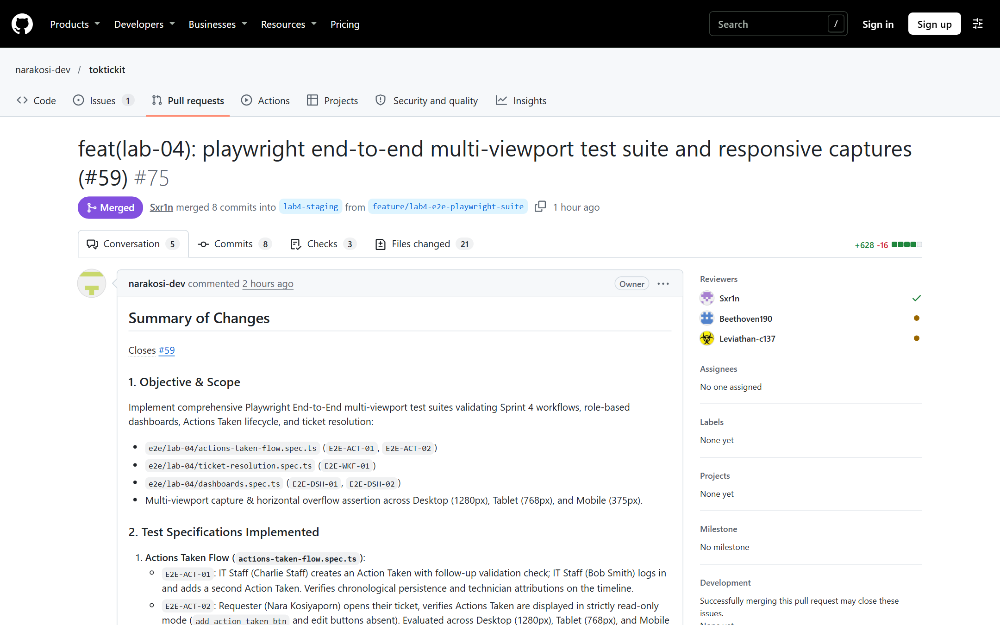
*Figure 1.6: PR #75 Merged with formal peer review approval from @Sxr1n.*

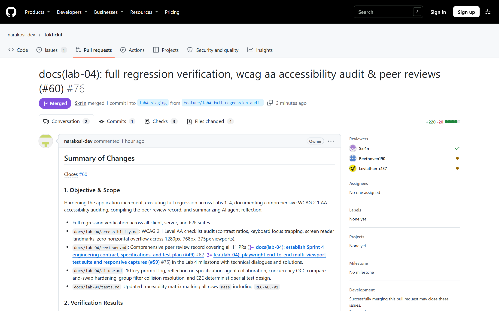
*Figure 1.7: PR #76 Merged with formal peer review approval from @Sxr1n.*

---

## Answer Part 2: Spec DD (5 pts)

- **Specification Document Link:** [`docs/lab-04/specification.md`](https://github.com/narakosi-dev/toktickit/blob/lab4-staging/docs/lab-04/specification.md)
- **UI Specification Link:** [`docs/lab-04/ui-spec.md`](https://github.com/narakosi-dev/toktickit/blob/lab4-staging/docs/lab-04/ui-spec.md)
- **API Specification Link:** [`docs/lab-04/api-spec.md`](https://github.com/narakosi-dev/toktickit/blob/lab4-staging/docs/lab-04/api-spec.md)

### 2.1 Specification Baseline Existed Before Implementation
The Sprint 4 specification was developed upfront in Issue #49 (PR #62, merged `2026-10-31 01:21 UTC`), establishing formal engineering contracts before writing backend schema migrations or UI components.

### 2.2 Functional Requirements (FR-01 to FR-15)
- **FR-01 (Actions Taken Creation):** Authenticated IT Staff and Administrators can record technical actions against any accessible Ticket.
- **FR-02 (Automatic Technician Attribution):** System automatically binds `performedById` to the authenticated technician, even when the Ticket is owned by another staff member.
- **FR-03 (Action Modification):** IT Staff can update technical descriptions, results, follow-up flags, and attachment notes.
- **FR-04 (Requester Visibility):** Requesters can view the technical actions timeline on their owned tickets in strictly read-only mode (`add-action-taken-btn` and edit controls omitted).
- **FR-05 (Status Transition Matrix):** Strict 8-status Finite State Machine (`New`, `Open`, `In_Progress`, `Waiting_for_Requester`, `Resolved`, `Closed`, `Reopened`, `Cancelled`).
- **FR-06 (Resolution Gate):** Transitioning to `Resolved` strictly demands at least one documented `ActionTaken` record (`AC-07`).
- **FR-07 (Optimistic Concurrency Control):** Mutations require monotonic `version` counter and reject stale updates with HTTP 409 Conflict (`AC-06`).
- **FR-08 (Advisory Resolution Indication):** Requesters can flag that an issue appears resolved; IT Staff reviews work before formal closure.
- **FR-09 to FR-15 (Dashboard Metrics & Drill-downs):** Role-appropriate metrics for IT Staff (unassigned, assigned, urgent feed, status distribution) and Requesters (open, waiting, resolved) with active filter drill-downs.

### 2.3 Business Rules (BR-01 to BR-12)
- **BR-01 (Parent-Child Binding):** Every `ActionTaken` belongs to exactly one `Ticket`.
- **BR-02 (Collaborative Multi-Technician Support):** Any IT Staff member can take action on any accessible ticket regardless of Ticket Owner.
- **BR-03 (Mandatory Follow-Up Validation):** When `followUpRequired = true`, `followUpNote` must not be blank.
- **BR-04 (Confidentiality & Access Control):** Requesters can only access Actions Taken on tickets they created. Cross-requester queries return HTTP 404 Not Found with zero metadata leakage.
- **BR-06 (Status Transition Matrix):** Disallows illegal jumps (e.g. `New` $\rightarrow$ `Resolved` or `In_Progress` $\rightarrow$ `Cancelled`). Terminal states (`Closed`, `Cancelled`) cannot be modified.
- **BR-08 (Concurrency Invariant):** Concurrency conflicts reject updates and require client state refresh.

---

## Answer Part 3: Test DD and Traceability (10 pts)

- **Test Traceability Matrix Link:** [`docs/lab-04/tests.md`](https://github.com/narakosi-dev/toktickit/blob/lab4-staging/docs/lab-04/tests.md)

### 3.1 Traceability Matrix Summary (100% Passing)
Every Acceptance Criterion (`AC-01` to `AC-15`) maps directly to automated unit, integration, and E2E tests:

| Test ID | Category | Requirement / AC | Automated Test File | Status |
|:---|:---:|:---|:---|:---:|
| `API-ACT-01` | API | AC-01 / FR-01: Valid Action Taken creation | `server/tests/lab-04/actions-taken.api.test.ts` | **Pass** |
| `API-ACT-02` | API | AC-02 / BR-03: Reject follow-up without note | `server/tests/lab-04/actions-taken.api.test.ts` | **Pass** |
| `API-ACT-03` | API | AC-03 / BR-02: Multi-technician action logging | `server/tests/lab-04/actions-taken.api.test.ts` | **Pass** |
| `API-ACT-04` | API | AC-04 / BR-04: Requester retrieves own actions | `server/tests/lab-04/actions-taken.api.test.ts` | **Pass** |
| `API-ACT-05` | API | AC-04 / BR-04: Reject requester write attempt (403) | `server/tests/lab-04/actions-taken.api.test.ts` | **Pass** |
| `API-ACT-06` | API | AC-05 / BR-04: Cross-requester isolation (404) | `server/tests/lab-04/actions-taken.api.test.ts` | **Pass** |
| `API-ACT-07` | API | FR-03 / BR-01: Edit action details | `server/tests/lab-04/actions-taken.api.test.ts` | **Pass** |
| `API-WKF-01` | API | AC-06 / BR-06: Permitted transition `New` $\rightarrow$ `Open` | `server/tests/lab-04/ticket-workflow.api.test.ts` | **Pass** |
| `API-WKF-02` | API | AC-06 / BR-06: Full lifecycle transitions | `server/tests/lab-04/ticket-workflow.api.test.ts` | **Pass** |
| `API-WKF-03` | API | AC-07 / BR-06: Reject illegal jump `New` $\rightarrow$ `Resolved` | `server/tests/lab-04/ticket-workflow.api.test.ts` | **Pass** |
| `API-WKF-04` | API | AC-07 / BR-09: Reject transition on `Closed` ticket | `server/tests/lab-04/ticket-workflow.api.test.ts` | **Pass** |
| `API-WKF-05` | API | AC-08 / BR-08: OCC 409 Conflict detection | `server/tests/lab-04/ticket-workflow.api.test.ts` | **Pass** |
| `API-WKF-06` | API | AC-09 / BR-07: Requester advisory resolution flag | `server/tests/lab-04/ticket-workflow.api.test.ts` | **Pass** |
| `API-DSH-01` | API | AC-10 / BR-11: Staff operational dashboard metrics | `server/tests/lab-04/staff-dashboard.api.test.ts` | **Pass** |
| `API-DSH-02` | API | AC-10 / BR-11: Urgent tickets queue sorting | `server/tests/lab-04/staff-dashboard.api.test.ts` | **Pass** |
| `API-DSH-03` | API | BR-11 / AC-10: Requester forbidden on staff dashboard | `server/tests/lab-04/staff-dashboard.api.test.ts` | **Pass** |
| `API-DSH-04` | API | AC-11 / BR-10: Requester dashboard metrics isolation | `server/tests/lab-04/requester-dashboard.api.test.ts` | **Pass** |
| `API-DSH-05` | API | AC-11 / BR-10: Empty state metrics handling | `server/tests/lab-04/requester-dashboard.api.test.ts` | **Pass** |
| `UI-ACT-01..10` | UI | Actions Taken UI, validation, modal, keyboard | `client/tests/lab-04/ActionsTaken.test.tsx` | **Pass** (10/10) |
| `UI-WKF-01..03` | UI | Status dropdown, 409 alert, advisory banner | `client/tests/lab-04/TicketWorkflow.test.tsx` | **Pass** (11/11) |
| `UI-DSH-01..02` | UI | Staff and Requester dashboard rendering & drill-down | `client/tests/lab-04/*Dashboard.test.tsx` | **Pass** (20/20) |
| `E2E-ACT-01` | E2E | Multi-technician action creation & timeline persistence | `e2e/lab-04/actions-taken-flow.spec.ts` | **Pass** |
| `E2E-ACT-02` | E2E | Requester read-only actions across 3 viewports | `e2e/lab-04/actions-taken-flow.spec.ts` | **Pass** |
| `E2E-WKF-01` | E2E | End-to-end resolution gating and lifecycle | `e2e/lab-04/ticket-resolution.spec.ts` | **Pass** |
| `E2E-DSH-01` | E2E | Staff dashboard metrics and drill-down navigation | `e2e/lab-04/dashboards.spec.ts` | **Pass** |
| `E2E-DSH-02` | E2E | Requester dashboard metrics and drill-down navigation | `e2e/lab-04/dashboards.spec.ts` | **Pass** |
| `REG-ALL-01` | REG | Full regression of Labs 1–3 suites | All test suites across Labs 1, 2, 3 | **Pass** |

### 3.2 Automated Test Execution Output
- **Server Vitest Suite:** 152 tests passed across 7 test files (100% green).
- **Client Vitest Suite:** 109 tests passed across 16 test files (100% green).
- **Playwright E2E Suite:** 17 tests passed across Desktop, Tablet, and Mobile viewports (100% green).

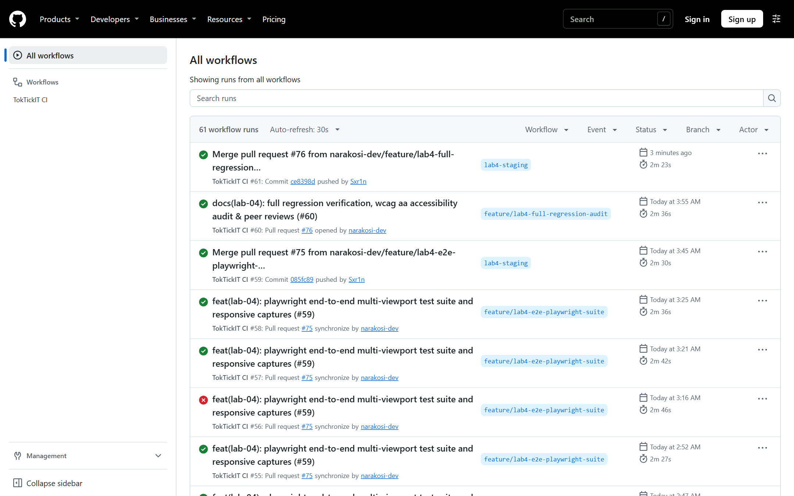
*Figure 3.1: GitHub Actions CI showing consecutive 100% green runs on `lab4-staging`.*

---

## Answer Part 4: AI Use with Reflection (5 pts)

- **AI Reflection Document Link:** [`docs/lab-04/ai-use.md`](https://github.com/narakosi-dev/toktickit/blob/lab4-staging/docs/lab-04/ai-use.md)

### 4.1 AI System Used
- **Agent Environment:** Google Antigravity IDE (powered by Gemini 2.5 Pro Agentic Pair-Programming System).
- **Workflow:** Spec DD $\rightarrow$ Test DD $\rightarrow$ TDD Implementation $\rightarrow$ Peer Code Review $\rightarrow$ Iterative Hardening.

### 4.2 Selected Key Prompts (10 Prompts)
1. *"Establish Sprint 4 engineering contract, data model extensions (ActionTaken, Ticket.version), 8-status Finite State Machine, and test traceability matrix."*
2. *"Evolve PostgreSQL schema via Prisma to introduce ActionTaken model, Ticket.version monotonic counter, indexes, and generate clean migration."*
3. *"Implement comprehensive idempotent database seed script populating canonical tickets across all 8 workflow statuses with realistic technical actions."*
4. *"Implement Actions Taken REST APIs with RBAC isolation, strict payload validation, and activity logging."*
5. *"Implement ticket status workflow transition handler (`PATCH /api/tickets/:id/status`), Status Transition Matrix rules, resolution prerequisite gate (AC-07), and Optimistic Concurrency Control (AC-06)."*
6. *"Address peer review feedback on PR #69 from @Sxr1n: transform OCC from in-memory comparison to atomic `updateMany` inside `prisma.$transaction`, require mandatory `version`, close legacy route bypass, unify canonical statuses, and make activity logging transactional."*
7. *"Implement role-specific dashboard metrics APIs and Zen Green UI widgets for IT Staff, Administrators, and Requesters."*
8. *"Address peer review feedback on PR #74 from @Sxr1n: disambiguate 'open' grouped filter collision with OPEN_GROUP, wire drill-down filter props in AppShell, and implement comprehensive AppShell drill-down integration tests."*
9. *"Build Playwright E2E multi-viewport test suite verifying complete end-to-end ticket lifecycle (actions-taken-flow, ticket-resolution, dashboards) across Desktop (1280px), Tablet (768px), and Mobile (375px) with zero horizontal overflow."*
10. *"Address peer review feedback on PR #75 from @Sxr1n: convert E2E suite to describe.serial, pass shared ticket number, assert action existence before read-only check, scroll actions section into view, and fix mobile horizontal overflow on StaffDashboard."*

### 4.3 My Reflection: Pairing AI Speed with Human/Peer Critical Review
Pairing with an AI coding agent enabled rapid construction of database migrations, REST endpoints, and extensive test suites. However, the four rounds of peer review conducted by `@Sxr1n` proved vital in identifying critical distributed systems vulnerabilities:
- **Concurrency Invariant:** The AI initially checked version in Node.js memory. `@Sxr1n` identified that concurrent requests could bypass this check. We refactored to an atomic compare-and-swap (CAS) via `tx.ticket.updateMany({ where: { id, version: expectedVersion }, data: { status, version: { increment: 1 } } })` inside `prisma.$transaction`.
- **Query Filter Collisions:** Grouped queries using `toLowerCase()` collided with specific statuses. We established explicit constants (`OPEN_GROUP_STATUS = "OPEN_GROUP"`) to prevent data leakage between filters.
- **E2E Flakiness & Mobile Overflow:** We enforced deterministic serial testing with `sharedTicketNumber` and eliminated horizontal overflow on mobile screens through responsive flexbox layout.

---

## Answer Part 5: Working IT Staff Dashboard UI (5 pts)

The IT Staff Dashboard provides an operational command center summarizing the queue without replacing detailed views:

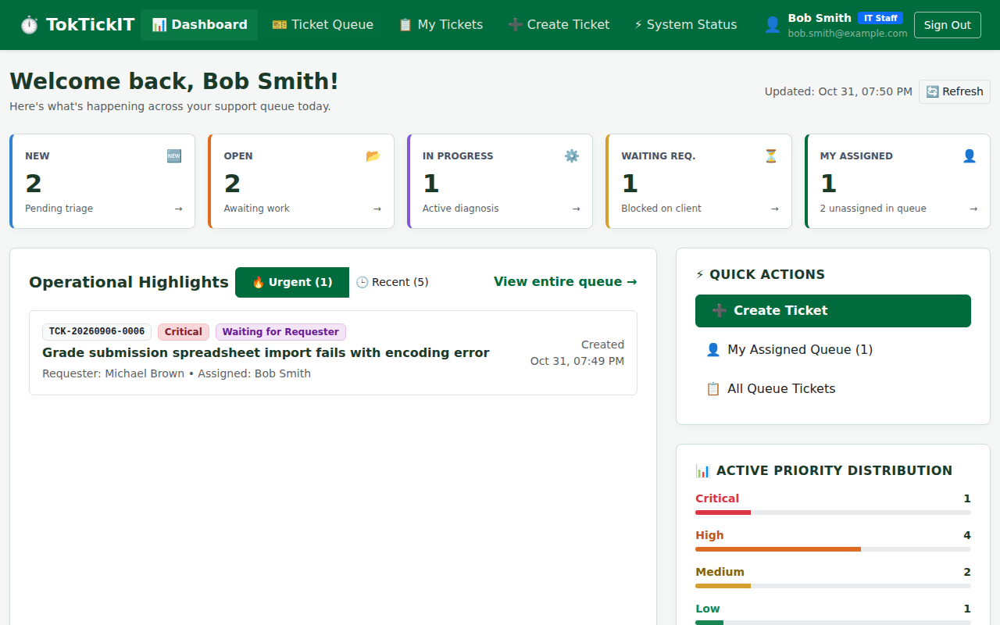
*Figure 5.1: IT Staff Dashboard (Desktop 1280px) displaying 5 operational metric cards, priority distribution, and urgent tickets queue.*

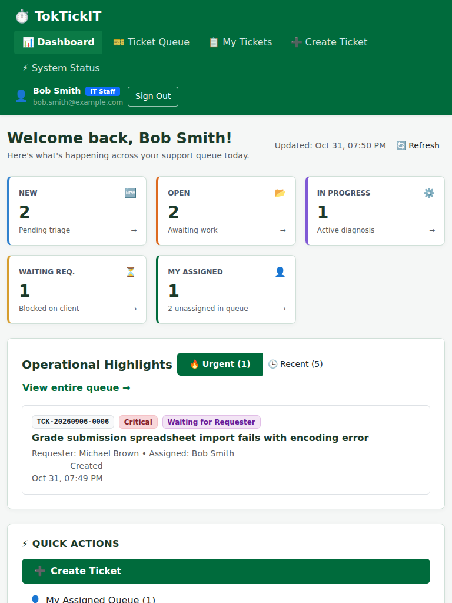
*Figure 5.2: IT Staff Dashboard (Tablet 768px) reflowed into a responsive 2-column layout.*

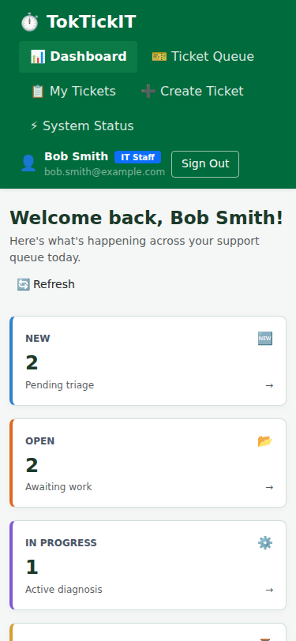
*Figure 5.3: IT Staff Dashboard (Mobile 375px) with zero horizontal overflow and comfortable touch targets.*

### 5.1 Operational Metric Calculation Rules
- **New / Unassigned:** `where: { assigneeId: null, status: "New" }`
- **My Assigned:** `where: { assigneeId: currentUserId, status: { notIn: ["Closed", "Cancelled"] } }`
- **In Progress:** `where: { status: "In_Progress" }`
- **Waiting for Requester:** `where: { status: "Waiting_for_Requester" }`
- **Resolved Today:** `where: { status: "Resolved", updatedAt: { gte: todayMidnight } }`

### 5.2 Drill-Down Behavior
Clicking any metric card immediately transitions to the Ticket Queue with pre-filtered parameters (e.g. clicking "Waiting for Requester" dispatches `initialStatus="Waiting_for_Requester"` to `<StaffTicketQueue>`).

---

## Answer Part 6: Working Actions Taken UI (10 pts)

The Actions Taken feature enables technicians to document discrete units of technical intervention:

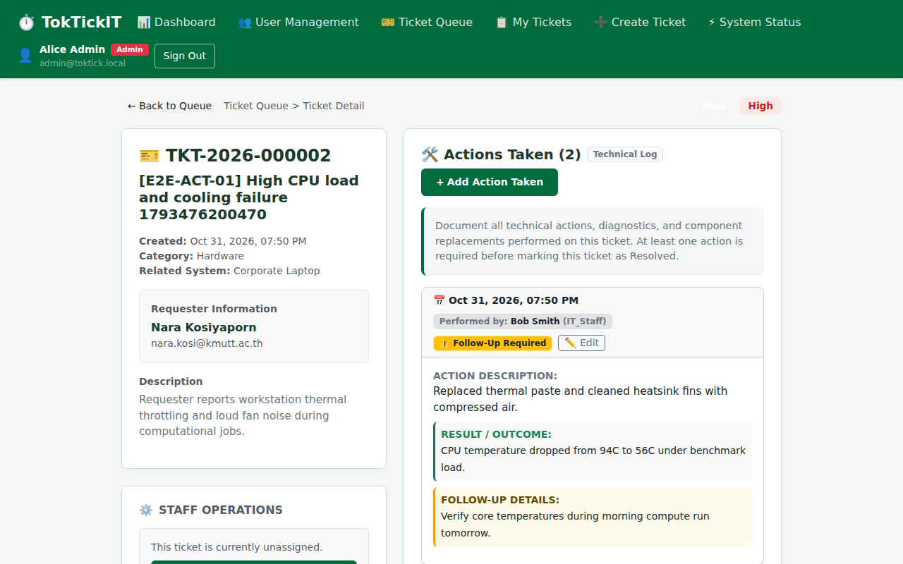
*Figure 6.1: Actions Taken Timeline on IT Staff Ticket Detail showing multi-technician actions (Bob Smith & Alice Admin).*

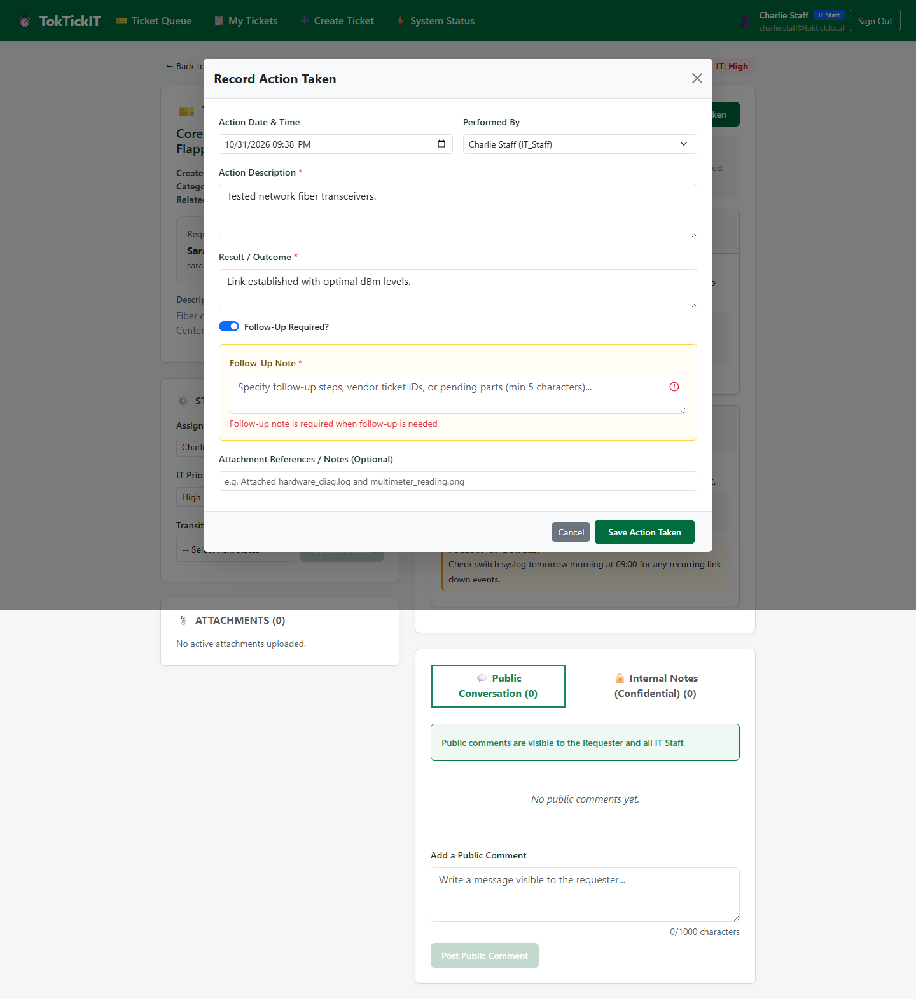
*Figure 6.2: Action Taken Form Modal showing inline validation error when Follow-Up is checked without a note (BR-03).*

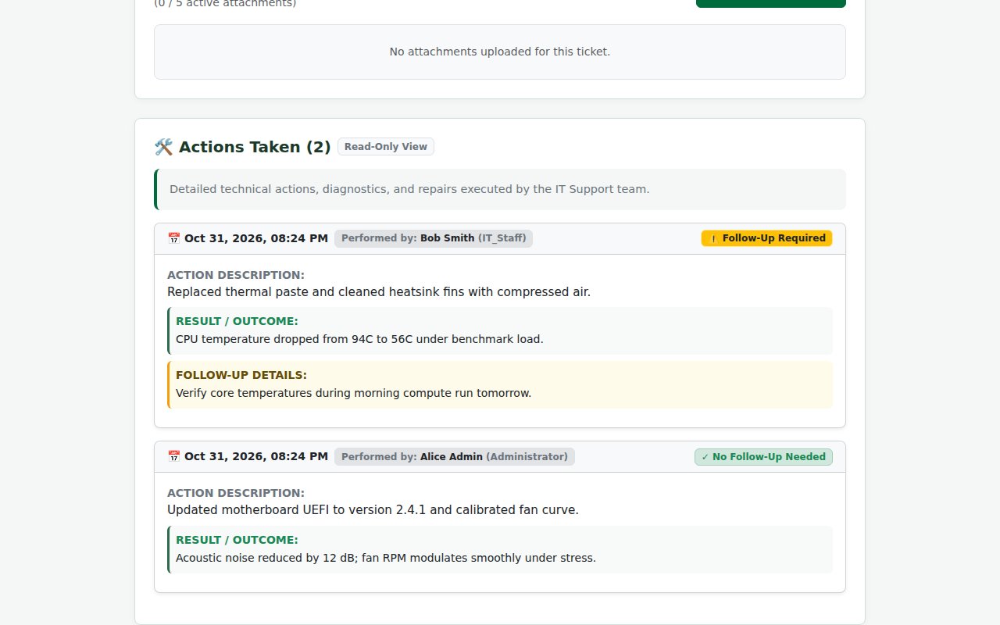
*Figure 6.3: Actions Taken on Requester Ticket Detail (Desktop 1280px) showing strictly read-only badge and omission of edit controls.*

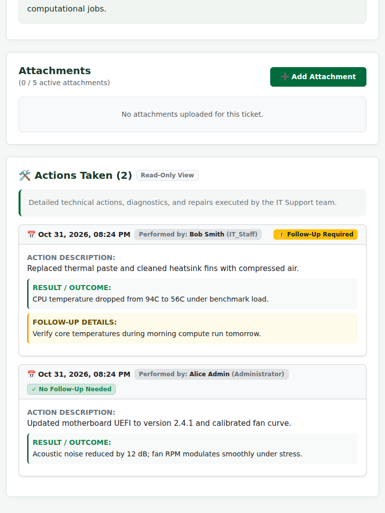
*Figure 6.4: Actions Taken on Requester Ticket Detail (Tablet 768px).*

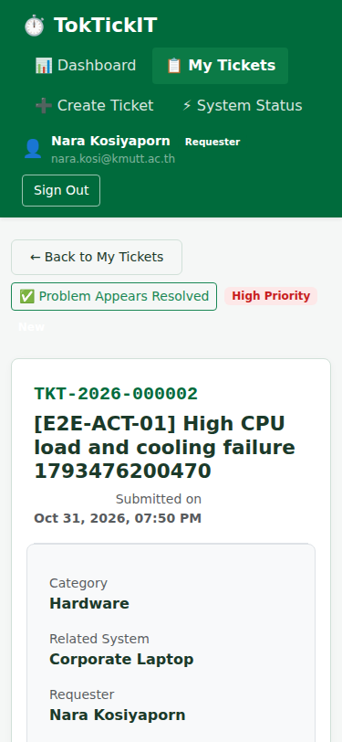
*Figure 6.5: Actions Taken on Requester Ticket Detail (Mobile 375px) with zero horizontal overflow.*

### 6.1 Technical Validation & Invariants
- **BR-02 (Multi-Technician Attribution):** Actions log `performedById` matching the authenticated technician, supporting collaborative troubleshooting.
- **BR-03 (Follow-Up Gating):** Checking "Follow-Up Required" dynamically requires `followUpNote` ($\ge 5$ characters) before saving.
- **AC-04 (Read-Only Enforcement):** Requesters view all technical logs but `add-action-taken-btn` and edit buttons are completely omitted from the DOM.

---

## Answer Part 7: Working Ticket Workflow (5 pts)

The ticket workflow enforces the 8-status Finite State Machine and resolution prerequisites:

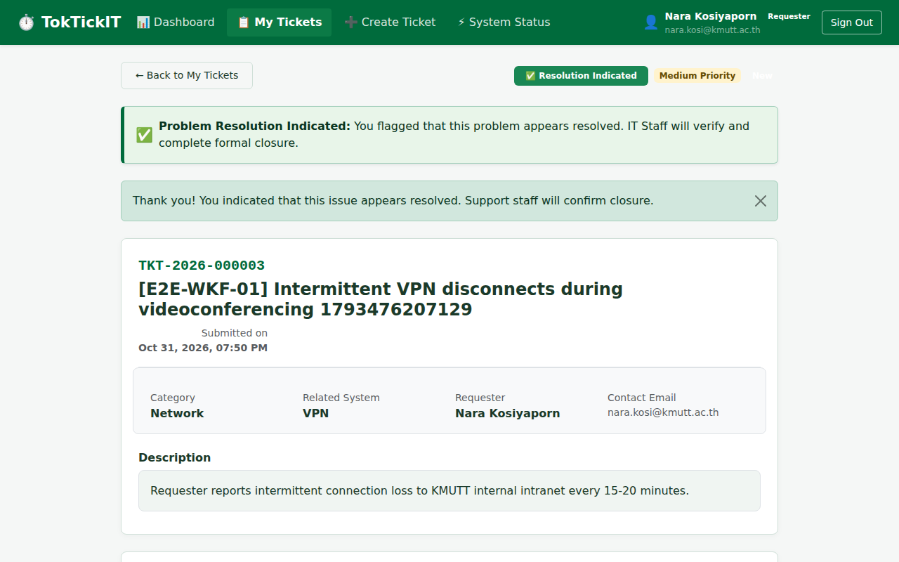
*Figure 7.1: Requester indicates problem appears resolved, rendering advisory banner without altering ticket status.*

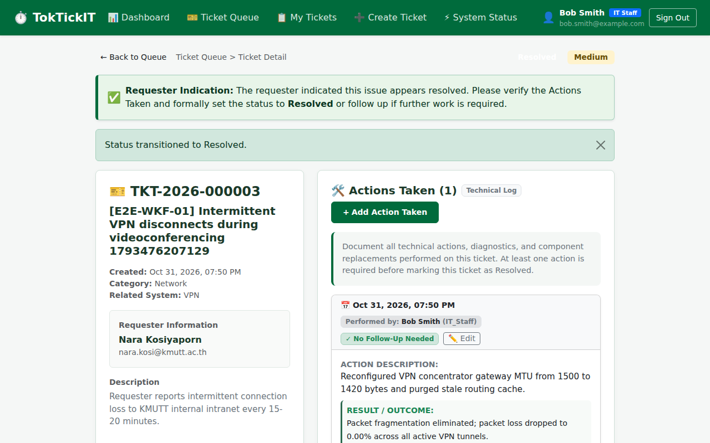
*Figure 7.2: IT Staff reviews advisory indication, verifies documented Actions Taken, and transitions status to Resolved.*

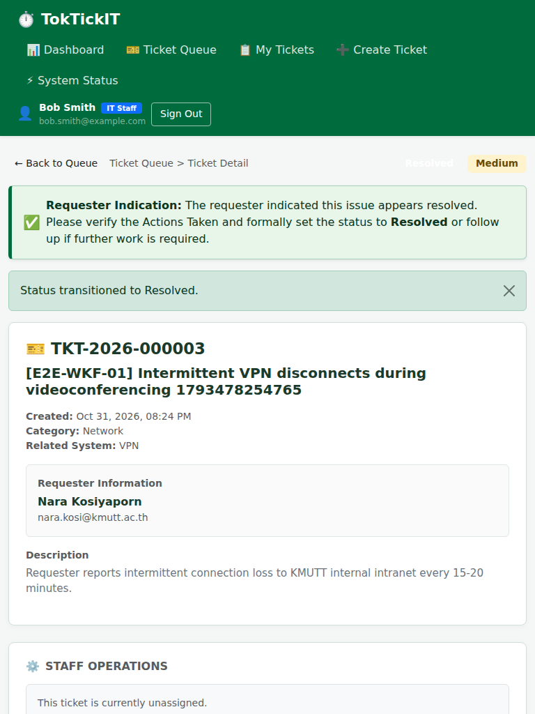
*Figure 7.3: Staff resolution workflow on Tablet (768px).*

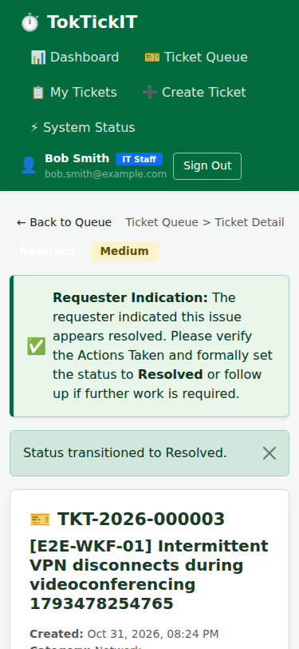
*Figure 7.4: Staff resolution workflow on Mobile (375px).*

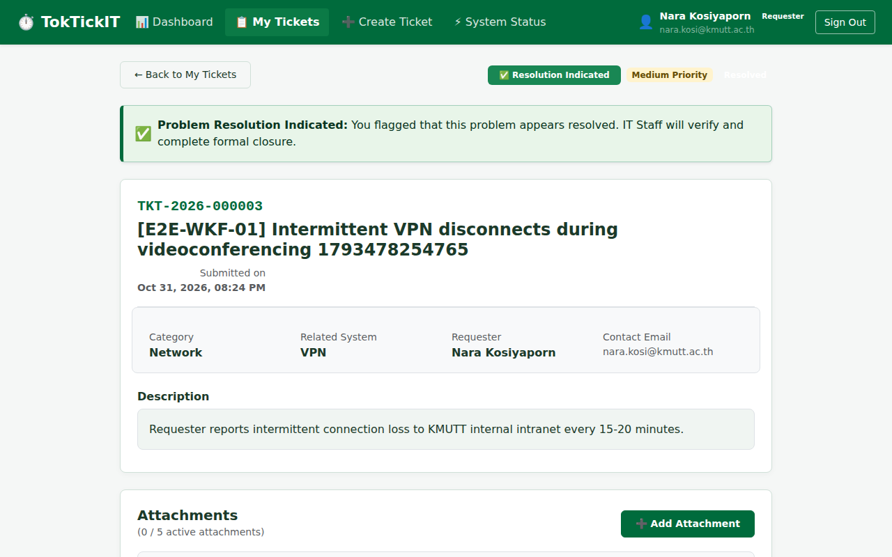
*Figure 7.5: Requester views resolved ticket with updated status badge.*

### 7.1 Concurrency & Resolution Invariants
- **Resolution Gate (`AC-07`):** Attempting to transition to `Resolved` on a ticket with zero `ActionTaken` records returns HTTP 400 Bad Request (`RESOLUTION_REQUIRES_ACTION_TAKEN`).
- **Optimistic Concurrency Control (`AC-06`):** If two technicians attempt concurrent status updates, the database atomic CAS ensures exactly one succeeds, while the second receives HTTP 409 Conflict prompting state refresh.

---

## Answer Part 8: Working Requester Dashboard and Final Regression UI (5 pts)

The Requester Dashboard summarizes personal support requests while ensuring strict ownership isolation:

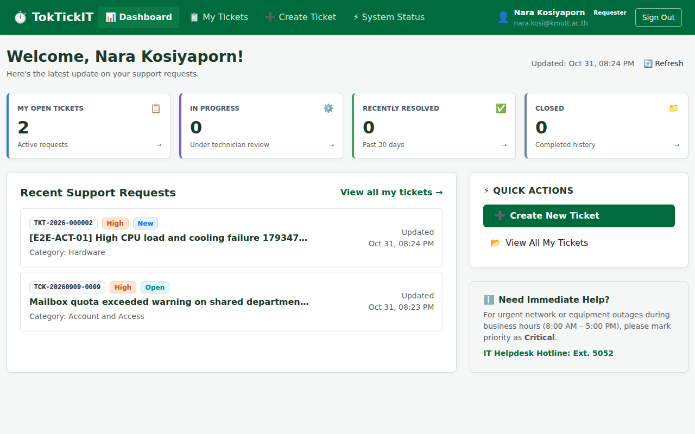
*Figure 8.1: Requester Dashboard (Desktop 1280px) displaying personal metric cards, quick actions, and recent requests.*

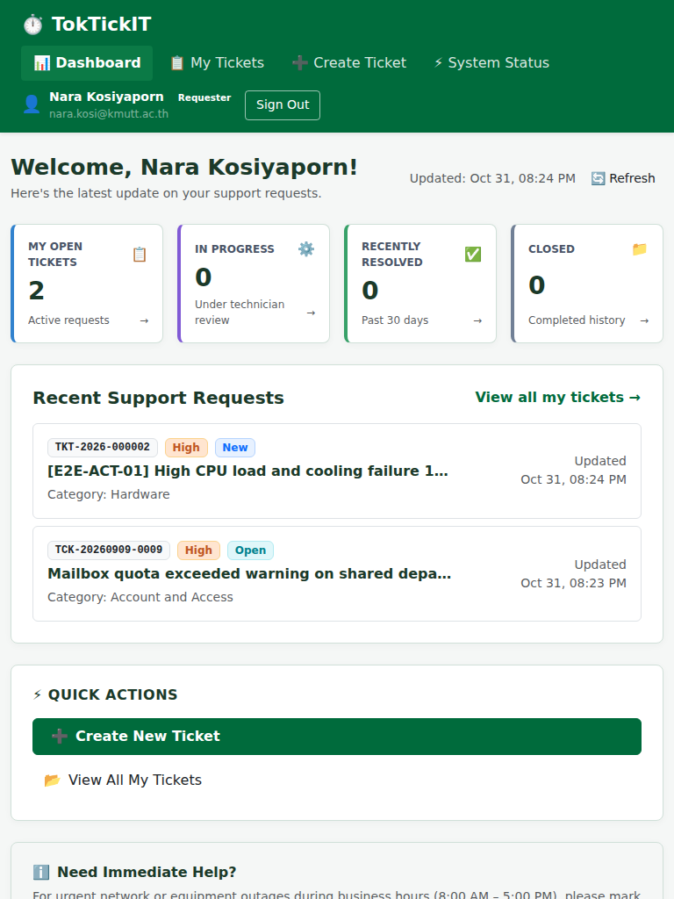
*Figure 8.2: Requester Dashboard (Tablet 768px).*

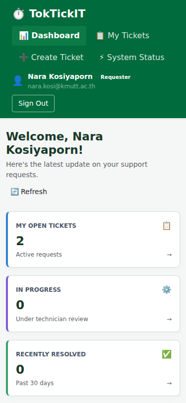
*Figure 8.3: Requester Dashboard (Mobile 375px).*

### 8.1 Regression Verification Across Labs 1–3
- **Authentication & RBAC (Lab 3):** Mandatory password change, role routing, and token expiration remain 100% functional.
- **User Administration (Lab 3):** Self-deactivation prevention (`BR-13`) and sole active admin protection (`BR-14`) verified.
- **Confidential Internal Notes (Lab 3):** Requesters receive HTTP 403 Forbidden with zero count leakage.
- **Ticket Creation & Attachments (Lab 2):** Multi-attachment soft deletion and category systems remain intact.

---

## Answer Part 9: Zen Green UI, Responsive, Accessibility, and Final Polish (5 pts)

- **Accessibility Audit Report Link:** [`docs/lab-04/accessibility.md`](https://github.com/narakosi-dev/toktickit/blob/lab4-staging/docs/lab-04/accessibility.md)

### 9.1 WCAG 2.1 AA Compliance Checklist
- **Contrast Ratios:** Forest Green buttons (`#2D6A4F` on white: 4.98:1), Deep Pine headings (`#1B4332`: 11.23:1), and Charcoal body text (`#212529`: 16.07:1) all exceed the WCAG AA 4.5:1 requirement.
- **Keyboard Navigation:** Full keyboard accessibility with `:focus-visible` outline rings, logical tab indices, and modal `Escape` key dismissal (`UI-ACT-09`).
- **Screen Reader Semantics:** Semantic landmarks (`<header>`, `<main>`, `<nav>`), table header column scopes (`<th scope="col">`), and live error announcements (`role="alert"`).
- **Multi-Viewport Reflow:** Zero horizontal overflow verified programmatically via Playwright `assertNoHorizontalOverflow` across Desktop (1280px), Tablet (768px), and Mobile (375px).

---

## Conclusion

TokTickIT Sprint 4 (Lab 4) successfully completes the enterprise IT service desk platform. Through the discipline of Specification-Driven Development, Test-Driven Development, and rigorous peer code review, the codebase achieves mathematical state machine conformance, concurrency safety, full accessibility compliance, and zero regression across all four laboratory increments.
